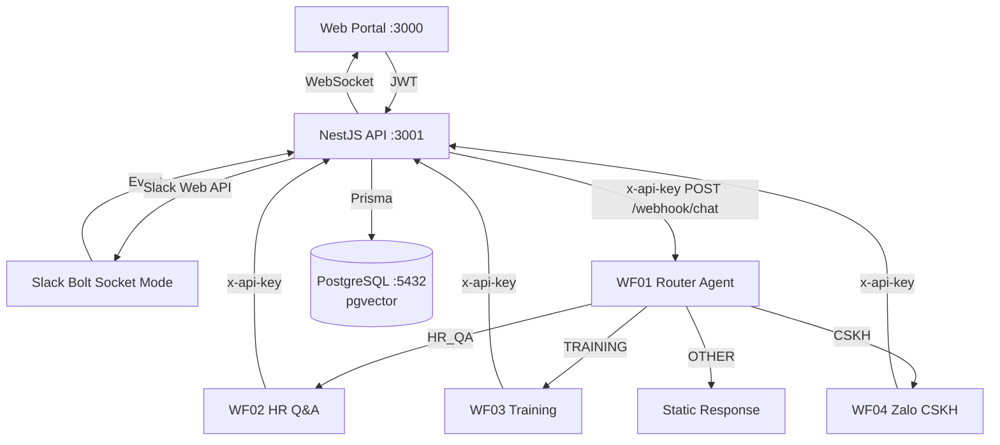

# 🤖 Kiến Trúc Hệ Thống & Multi-Agent

## Tổng Quan Kiến Trúc

Hệ thống theo mô hình **Client-Server** phân tách rõ ràng, quản lý dưới dạng **Monorepo** (Turborepo + pnpm workspaces). Vai trò User: **ADMIN** và **EMPLOYEE** (2 role duy nhất).

---

## 4 Điểm Nhấn Công Nghệ Đột Phá

### 2.1 📡 Router Agent (Phân loại ý định)

- **Vai trò:** "Tổng đài viên thông minh" — Webhook `POST /webhook/chat`
- **Thiết kế:** Khung **PEAS** (Performance, Environment, Actuators, Sensors)
- **Flow (refactor 17/09 — 0 LLM call):**
  1. Nhận message từ client (Web Portal / Slack)
  2. **PII Masking** — che thông tin nhạy cảm (Regex)
  3. **Keyword Intent Classifier** — phân loại bằng JavaScript regex thuần túy (không gọi Gemini)
  4. Switch router → route tới đúng agent
- **Output intent:** `HR_QA` | `TRAINING` | `CSKH` | `OTHER` (static message)

> [!NOTE]
> **Lý do bỏ Gemini Intent Classifier (17/09):** Free-tier giới hạn 15 RPM. Mỗi request tốn 1 LLM call cho classifier + 2-4 cho sub-agent = 3-7 calls/request. Sau refactor: 0 + 1-3 = **1-3 calls/request** (-50–66% quota).

### 2.2 👥 Nhóm Tác Tử Nghiệp Vụ

#### 💼 HR Agent (Nội bộ — WF02)
- **Lương/thưởng** → **Rule Engine** (lập trình cứng, 7 bậc PIT, cap BH 36M) → chính xác tuyệt đối
- **Hỏi đáp luật lao động** → **RAG + pgvector**: kho tri thức `policy_chunks` (embedding Gemini 768 dims) + tool `SearchPolicyKnowledge`
- **maxIterations: 3** (giảm từ 5, 17/09)
- Flow n8n: Lấy context nhân viên → Session → Gemini + system prompt → Lưu message
- **ADR-0001 ✅:** Postgres Chat Memory là nguồn duy nhất
- **ADR-0002 ✅:** n8n gọi NestJS endpoint `/n8n/knowledge-search` (không kết nối DB trực tiếp)

#### 📚 Training Agent (Nội bộ — WF03)
- **Đóng vai AI (Role-play Simulation):** Nhân viên thực hành kịch bản giả lập
- **6 kịch bản:** `CUSTOMER_COMPLAINT` | `COLLEAGUE_CONFLICT` | `MANAGER_FEEDBACK` | `NEW_EMPLOYEE_ONBOARDING` | `PERFORMANCE_REVIEW` | `GENERAL_COMMUNICATION`
- **Chấm điểm** 4 tiêu chí: Professional, Empathy, Problem-solving, Clarity (0-10)
- **Anti-cheat (#7):** Server stash đáp án, submit grading không tin client
- **Scoring:** `totalScore = quizScore×0.5 + essayAvg×10×0.5`

#### 📞 CSKH Agent (Ngoại bộ — WF04, Slack Transport)
- Giao tiếp với khách hàng qua **Slack channel** (demo cho Zalo OA) thông qua n8n
- **Human-in-the-loop:** Khi phát hiện khiếu nại phức tạp:
  1. n8n bắn **Webhook** → NestJS Backend
  2. NestJS đẩy **WebSocket notification** → Web Portal (mỗi Admin nhận 1 notification)
  3. HR Admin tiếp quản hội thoại (reply trong thread)
- **Midnight reset:** Cron 00:00 VN bật lại tất cả session đã escalate

### 2.3 🔐 PII Anonymization

- **Vị trí:** WF01 Code node (trước phân loại intent)
- **Quy trình:** Regex masking (số CCCD, số điện thoại, email) → LLM chỉ thấy `maskedMessage`
- Sau refactor 17/09: cả Intent Classifier và Direct Answer cũ đều bị xóa → **không có LLM nào trong WF01 thấy dữ liệu chưa mask**

### 2.4 ⚡ WebSocket Real-time (#14 Security)

- NestJS dùng `@nestjs/websockets` + `socket.io`
- **JWT verified tại handshake** — token không hợp lệ → `disconnect(true)` ngay
- Chỉ **ADMIN** mới join được room `admin` (xem AI activity)
- Real-time notification cho Admin khi có khiếu nại CSKH

---

## LLM Sử Dụng

| Agent | LLM | Ghi chú |
|-------|-----|----------|
| Router (WF01) | ❌ Không dùng LLM | Keyword classifier (refactor 17/09) |
| HR Q&A (WF02) | Google Gemini 3.1 Flash Lite | RAG + employee context, maxIterations: 3 |
| Training (WF03) | Google Gemini 3.1 Flash Lite | Role-play + scoring + quiz gen/grade |
| CSKH Zalo (WF04) | Google Gemini 3.1 Flash Lite | Customer support (Slack transport) |
| Verify (WF05) | ❌ Không dùng LLM | Slack Events API challenge |
| Embedding | Gemini `gemini-embedding-001` | 768 dims — index `policy_chunks` |

**API Key:** Google AI Studio (free tier: 15 RPM, 500 req/ngày)

---

## ADR Alignment (Verified 17/10/2026)

| ADR | Tóm tắt | So khớp code |
|-----|---------|------------|
| ADR-0001 | PostgreSQL chat memory duy nhất | ✅ WF02/WF04 dùng Postgres Chat Memory node, không buffer in-memory |
| ADR-0002 | NestJS làm RAG middleware | ✅ `KnowledgeService.search()` pgvector `<=>` + cosine fallback |
| ADR-0003 | Web-only Phase 1 | ✅ `apps/mobile` không tồn tại, `channel: mobile` giữ reserved |

> Chi tiết: Xem `[[30 - Business Logic & ADR Alignment (Verified 17-10-2026)]]` mục 8

---

*Liên kết:* [[00 - Tổng Quan Dự Án]] | [[06 - n8n Workflows & AI Agents]] | [[30 - Business Logic & ADR Alignment (Verified 17-10-2026)]]