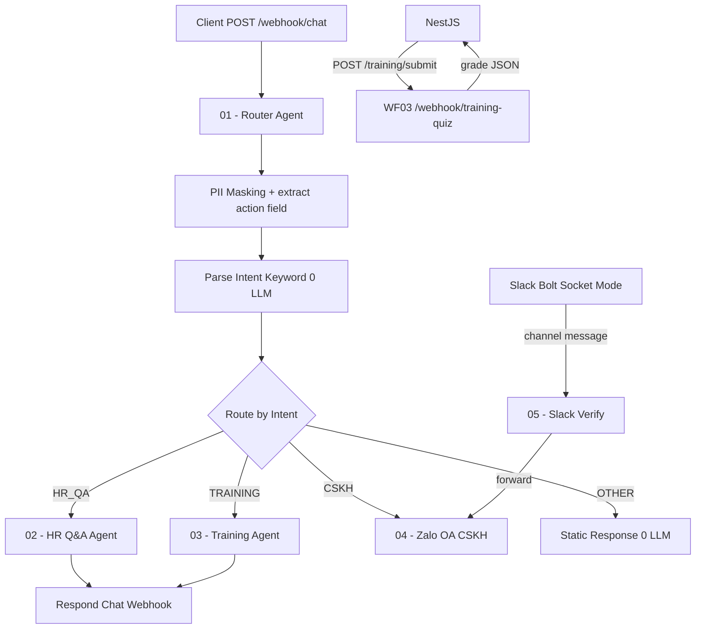

# 🤖 n8n Workflows & AI Agents

## Tổng Quan

**n8n** là nền tảng điều phối (orchestration) kết nối các AI Agent, chạy qua **Docker** tại `http://localhost:5678`.
Hệ thống sử dụng mô hình **DeepSeek `deepseek-flash`** (node `DeepSeek Chat`, credential `DeepSeek account`) cho các sub-agent WF02/03/04, với `maxTokens: 1024`. RAG vẫn dùng **`gemini-embedding-001`**.

> [!IMPORTANT]
> **03/11/2026 — chuyển từ Gemini sang DeepSeek:** Gemini 3.1 Flash Lite trả 503 "high demand" và bị giới hạn request/ngày. Các mục bên dưới còn nhắc `gemini-3.1-flash-lite` là lịch sử trước ngày này. Chi tiết: [[33 - Chuyển AI Agent Sang DeepSeek & Rà Soát Logic UI (03-11-2026)]].

> [!NOTE]
> **WF01 Router Agent — 0 LLM call (refactor 17/09):**
> Router không còn gọi Gemini để phân loại intent. Thay vào đó dùng **keyword-based classifier** thuần JavaScript (Code node) → tiết kiệm 1 Gemini call/request.
> Nhánh `OTHER` trả **static message** hướng dẫn người dùng chọn đúng module — không tốn LLM call, không rò PII.

> [!NOTE]
> **(Lịch sử) Lựa chọn mô hình `gemini-3.1-flash-lite` (cập nhật 21/09, thay bằng DeepSeek từ 03/11):** 500 requests/ngày (15 RPM), phản hồi siêu tốc (~1-2s), hỗ trợ đầy đủ Tool Calling và vượt trội hạn mức so với các bản Flash 20 RPD.

Thư mục lưu trữ: `n8n-workflows/` — gồm **5 workflows JSON** đã được cấu hình credentials và published lên n8n.

---

## Kiến Trúc Điều Phối & Tích Hợp



---

## Workflow 01 — Router Agent 📡

- **Webhook endpoint:** `POST /webhook/chat`
- **Model:** ❌ Không dùng LLM (refactor 17/09)
- **Cơ chế:** Keyword-based JavaScript regex — xử lý `maskedMessage`
  - `HR_QA`: lương, phép, hợp đồng, BHXH, chấm công, thuế TNCN...
  - `TRAINING`: training, đào tạo, role-play, **bài test, quiz, trắc nghiệm, bài kiểm tra**...
  - `CSKH`: khiếu nại, khách hàng, dịch vụ...
  - `OTHER`: fallback → static message
- **`action` field (17/09):** PII Masking extract `body.action`. Parse Intent tự đặt `action='generate_quiz'` khi detect quiz keywords.

---

## Workflow 02 — HR Q&A Agent 💼

- **Kích hoạt:** `Execute Workflow Trigger` từ WF01
- **Model:** `deepseek-flash` (từ 03/11; trước đó `models/gemini-3.1-flash-lite`) (Temperature: 0.3, **maxIterations: 3**)
- **Bộ nhớ:** `Postgres Chat Memory` bảng `n8n_chat_histories`
- **AI Tools:** `GetEmployeeContext`, `GetPayrollContext`, `SearchPolicyKnowledge` (RAG `policy_chunks`)

> [!TIP]
> **ADR-0001 alignment ✅:** Postgres Chat Memory là nguồn sự thật duy nhất cho lịch sử hội thoại. Xem `[[30 - Business Logic & ADR Alignment]]` mục 8.

> [!TIP]
> **ADR-0002 alignment ✅:** `SearchPolicyKnowledge` gọi vào NestJS endpoint `/n8n/knowledge-search` — n8n KHNG kết nối DB trực tiếp. Xem `KnowledgeService.search()`: pgvector `<=>` với fallback cosine in-app.

---

## Workflow 03 — Training Agent 🎮📝

### Dual-Trigger & 3 Luồng Xử Lý (17/09)

| Trigger | Path | `action` | Mô tả |
|---|---|---|---|
| ExecuteWorkflow (WF01) | Role-play | `null` | AI đóng vai, multi-turn, chấm 4 tiêu chí |
| ExecuteWorkflow (WF01) | Generate Quiz | `'generate_quiz'` | AI sinh 7 câu hỏi JSON |
| Webhook `/training-quiz` (NestJS) | Submit Quiz | `'submit_quiz'` | AI chấm điểm + trả kết quả |

### Cấu Trúc Node

```
Trigger A (executeWorkflowTrigger) ┌
                                   ├► Normalize Input ► Load Scenario ► Action Switch
Trigger B (Webhook /training-quiz) ┘                                          │
                                              ┌──────────────────────┤
                                     gen_quiz │   submit_quiz  │  role-play
                                              ↓               ↓         ↓
                                          Quiz Gen         Quiz Grade  Training Agent
                                          Agent            Agent       (Gemini Roleplay)
                                          (Gemini Gen)     (Gemini Grade)
                                              └──────────────────────┘
                                                  lastNode → HTTP Response
```

### Thông Số Kỹ Thuật

- **Model:** `deepseek-flash` (từ 03/11; trước đó `models/gemini-3.1-flash-lite`) — bản live 03/11 dùng **1 node `DeepSeek Chat`** nối vào cả 3 agent (Quiz Generator, Quiz Grader, Training) và chạy bình thường; tài liệu cũ ghi 3 node Gemini riêng biệt
- **Webhook mode:** `responseMode: 'lastNode'`
- **maxIterations:** Quiz agents = 1, Training roleplay = 3

> [!WARNING]
> **1 LLM node KHÔNG được kết nối vào nhiều Agent cùng lúc** → n8n lỗi khởi tạo (runData rỗng, status: error). Phải tạo node Gemini riêng cho mỗi Agent.

### Quiz Anti-Cheat (#7)

- **Server stash:** NestJS lưu đáp án đúng vào `AiChatMessage.metadata.quiz` khi WF03 sinh quiz
- **Submit grading:** Server đọc lại đáp án từ DB, **KHÔNG tin `correctAnswer` từ client**
- **Scoring:** `totalScore = quizScore×0.5 + essayAvg×10×0.5`, 4 tiêu chí (professional, empathy, problemSolving, clarity)
- **Chi tiết:** Xem `[[30 - Business Logic & ADR Alignment]]` mục 4

### Quiz Response Format

**`generate_quiz`** trả về JSON với 5 MCQ + 2 essay:
```json
{ "answer": "...", "questions": [{"id":1,"type":"mcq",...},{"id":6,"type":"essay",...}], "action": "generate_quiz" }
```

**`submit_quiz`** trả về kết quả chấm:
```json
{ "score_percent": 71, "correct_count": 4, "total_mcq": 5, "results": [...], "overall_feedback": "..." }
```

---

## Workflow 04 — Zalo OA CSKH Agent 📞 (Slack Transport)

- **Kích hoạt:** NestJS SlackModule (Bolt Socket Mode) — KHÔNG qua Zalo Webhook trực tiếp
- **Transport thực tế:** Khách chat Slack channel `#demo` → NestJS Bolt → WF04 webhook
- **Model:** `deepseek-flash` (từ 03/11; trước đó `models/gemini-3.1-flash-lite`) (Temperature: 0.5, maxIterations: 3)
- **Bộ nhớ:** `Postgres Chat Memory` bảng `n8n_chat_histories`

### Nodes quan trọng (17/09)
| Node | Chức năng |
|---|---|
| Input from Router | Nhận payload `slackChannel` + `threadTs` từ NestJS |
| Get/Create CSKH Session | Tạo/lấy session, trả `isActive` |
| Is Bot Active? (IF) | `isActive=false` → dừng, không reply |
| CSKH Agent | DeepSeek `deepseek-flash` với system prompt TechHRM |
| Should Escalate? | Phát hiện `[CAN_ESCALATE:]` tag |
| Escalate to Admin | POST `/n8n/escalate` → NestJS → WebSocket portal |
| Send Reply Outbound | POST `/ai-context/outbound-reply` với `slackChannel`+`threadTs` |

### System Prompt TechHRM (hardcode)
- Gói Basic: 500.000đ/tháng — 50 nhân viên
- Gói Pro: 1.200.000đ/tháng — 200 nhân viên  
- Gói Enterprise: Liên hệ — không giới hạn
- **Tool `SearchProductKnowledge` đã xóa** (TODO: implement RAG sau)

### Escalation triggers
- Khiếu nại nghiêm trọng, yêu cầu bồi thường
- Lỗi hệ thống, mất dữ liệu
- Yêu cầu gặp lãnh đạo
- Hỗ trợ kỹ thuật phức tạp

### Midnight Reset
- Cron `0 0 * * *` (Asia/Ho_Chi_Minh) trong NestJS `AiContextService`
- Reset toàn bộ session `isActive=false` → `isActive=true` lúc 00:00 VN
- Gửi greeting vào Slack channel (nếu có `SLACK_CHANNEL_ID`)

---

## Workflow 05 — Slack Verify 🔗 (mới)

- **File:** `n8n-workflows/05-slack-verify.json`
- **Mục đích:** Xác thực Slack Events API challenge (`url_verification`)
- **Transport:** NestJS `SlackModule` dùng Bolt SDK **Socket Mode** — WF05 là fallback cho HTTP mode

---

## Quota Optimization (17/09)

| Thành phần | Trước | Sau | Tiết kiệm |
|---|---|---|---|
| WF01 Intent Classifier | 1 Gemini call | 0 (keyword) | -1/request |
| WF01 Direct Answer OTHER | 1 Gemini call | 0 (static) | -1/request |
| WF02 maxIterations | 5 | 3 | -2 worst case |
| NestJS 429 handling | throw 502 | friendly answer | UX tốt hơn |
| **Tổng/request** | **3–7 calls** | **1–3 calls** | **-50–66%** |

---

## Script Triển Khai

| Script | Công dụng |
|---|---|
| `scripts/import-workflows.mjs` | Login, import và activate 5 WF |
| `scripts/generate-wf03.cjs` | Generate WF03 JSON (programmatic) |
| `scripts/fix-wf01-quiz-action.cjs` | Patch WF01 quiz keywords + action |
| `scripts/update-gemini-model.cjs` | Đổi model/credential toàn bộ WF |
| `scripts/test-all-wf.cjs` | Test tất cả 5 workflows cùng lúc |

---

## Vận hành n8n — Bài học debug ⚠️

1. **1 LLM node → nhiều Agent** → lỗi khởi tạo. Phải tạo node Gemini riêng cho mỗi Agent.
2. **`responseMode: 'responseNode'`** bị body rỗng khi path không reach respond node → dùng `'lastNode'`.
3. **WF03 từ executeWorkflow** chỉ nhận `action` field nếu WF01 PII Masking extract + Parse Intent forward đúng.
4. **PATCH workflow** phải deactivate → PATCH → activate. `credentials` ở node-level.
5. **n8n chặn `$env`** → dùng credential Header Auth "NestJS API Key".

---

*Liên kết:* [[10 - Nhật Ký Tích Hợp n8n & NestJS (E2E Test)]] | [[01 - Kiến Trúc Hệ Thống & Multi-Agent]] | [[14 - Training Quiz & Dashboard]] | [[30 - Business Logic & ADR Alignment (Verified 17-10-2026)]]