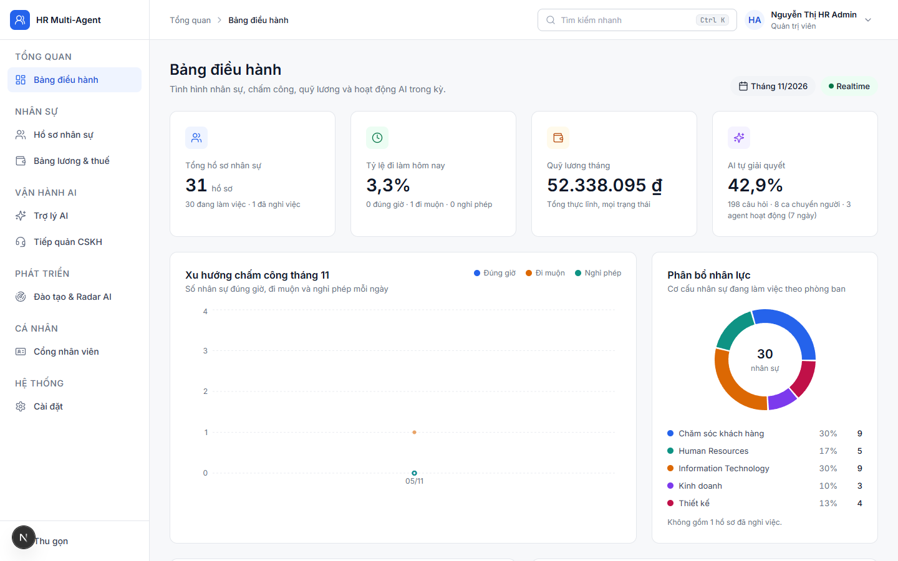
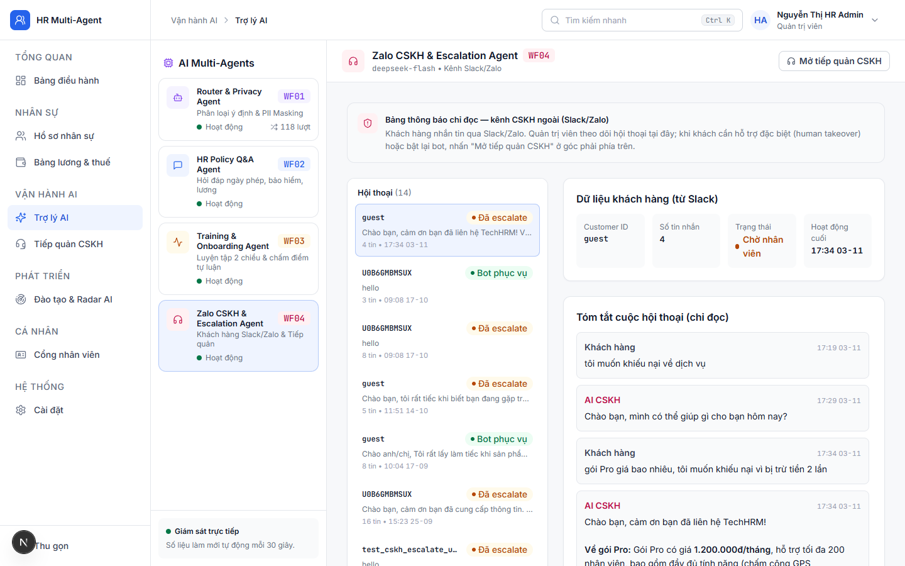
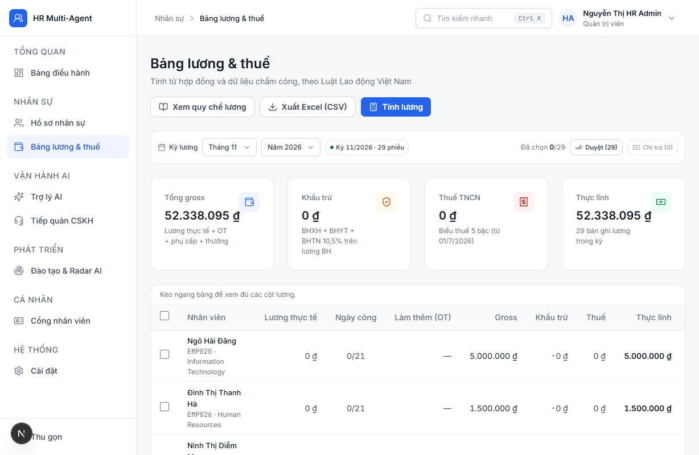
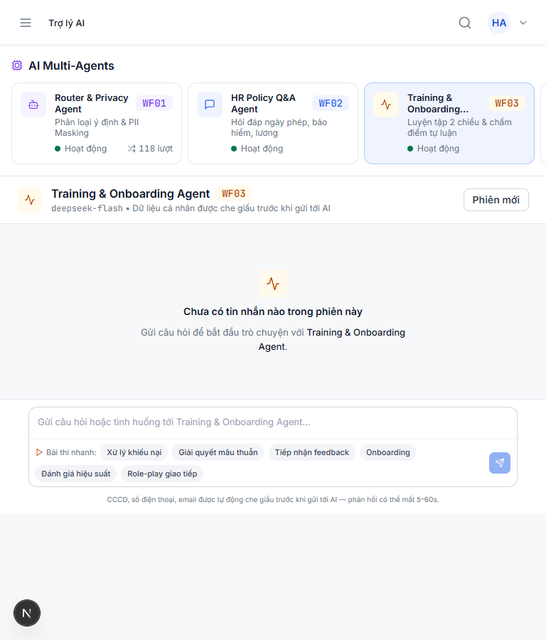
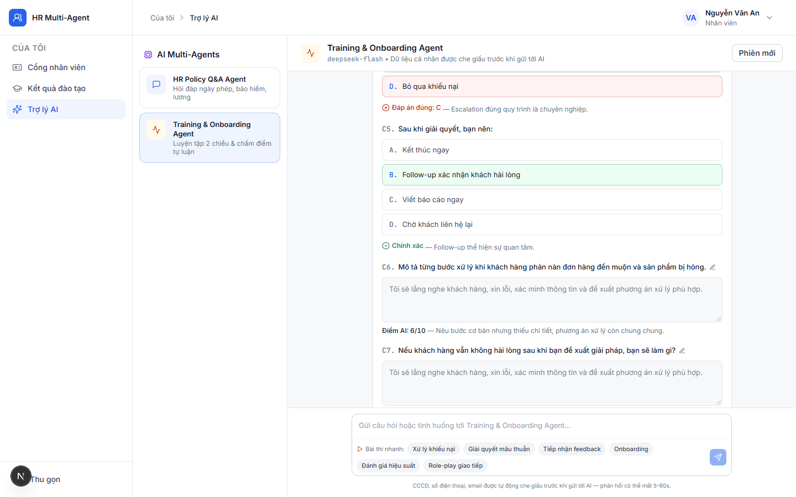

# 🔍 Audit Số Liệu, Sửa Encoding & Tinh Chỉnh Density (05-11-2026)

> [!IMPORTANT]
> Tiếp nối [[34 - Redesign Giao Diện Light Theme & Rà Soát UX Nhân Viên (04-11-2026)]]. Đợt này xử lý 4 nhóm việc: (1) đối chiếu toàn bộ GET endpoint với DB, (2) giải thích & sửa hiển thị 31 hồ sơ vs 30 nhân sự, (3) sửa dữ liệu chat bị hỏng encoding tiếng Việt, (4) giảm density toàn giao diện + tinh chỉnh toolbar bảng lương và composer chat. Không đổi logic nghiệp vụ, không xóa dữ liệu nhân sự/bảng lương.

## 1. Đối chiếu endpoint với DB

Mình gọi trực tiếp `http://localhost:3001/api/v1` bằng JWT admin, không đọc từ UI. **36 GET endpoint đều trả 200**, không có 5xx.

| Endpoint | Kết quả |
|---|---|
| `/employees?limit=100` | 31 hồ sơ: 23 ACTIVE · 4 PROBATION · 3 ON_LEAVE · 1 TERMINATED |
| `/dashboard/kpis` | `totalEmployees=30` · `terminatedEmployees=1` · `totalEmployeeRecords=31` |
| `/dashboard/department-distribution` | 30 (loại TERMINATED): 9 / 5 / 9 / 3 / 4 |
| `/training/dashboard/overview` | 30 (đã sửa để loại TERMINATED) |
| `/contracts` | 30: 29 active + 1 inactive (EMP018) |
| `/payroll?month=11&year=2026` | 29 bản ghi DRAFT |
| `/users` | 33 tài khoản |
| `/onboarding/progress` | 30 dòng |
| `/leave` | 8 đơn: 2 PENDING · 5 APPROVED · 1 REJECTED |
| `/training/analytics?month=11&year=2026` | 0 session trong tháng 11 |
| `/agents/conversations` | 14 hội thoại |
| `/agents/escalation-queue` | 6 phiên chờ |
| `/agents/pii-audit?limit=20` | 20 bản ghi |
| `/agents/intent-stats` | 118 lượt: HR_QA 68 · CSKH 7 · TRAINING 42 · OTHER 1 |
| `/notifications/my` | 12 thông báo |
| `/settings/integrations` | 4/4 OK: PostgreSQL, n8n, Slack, Gemini |

## 2. Vì sao 31 hồ sơ nhưng tổng chỉ 30?

**Không phải lỗi đếm.** Có 1 hồ sơ đã nghỉ việc:

- **Đoàn Anh Khoa — EMP018 — Thiết kế — `TERMINATED`**
- Hợp đồng `CTR-018` đã inactive, ngày kết thúc 31/07/2026.
- Không nằm trong payroll, onboarding, phân bổ phòng ban.

Các con số đúng:

| Chỉ số | Giá trị | Ý nghĩa |
|---|---:|---|
| Tổng hồ sơ | **31** | Tất cả record trong bảng `employees` |
| Đang làm việc | **30** | 23 ACTIVE + 4 PROBATION + 3 ON_LEAVE |
| Đã nghỉ việc | **1** | EMP018 |

### Đã sửa

- API `/dashboard/kpis` trả thêm `terminatedEmployees` và `totalEmployeeRecords`.
- Dashboard đổi thẻ KPI thành **“Tổng hồ sơ nhân sự 31”**, phụ đề **“30 đang làm việc · 1 đã nghỉ việc”**.
- Donut vẫn 30 (chỉ người đang làm việc), thêm chú thích “Không gồm 1 hồ sơ đã nghỉ việc”.
- `training/dashboard/overview` loại TERMINATED để không lệch 31 vs 30.
- Danh sách nhân sự ghi **“31 hồ sơ”** thay vì “31 nhân sự”.

## 3. Ba điểm lệch khác (dữ liệu, không phải lỗi đếm)

### 3.1. 29 bảng lương cho 30 người đang làm việc

- **EMP0031 — Nguyễn Văn Dang (PROBATION)** chưa có hợp đồng.
- `payroll.generateBulk` chỉ lấy người có hợp đồng hiệu lực → bỏ EMP0031.
- Chi tiết: 30 hợp đồng = 29 active + 1 inactive; EMP0031 không có hợp đồng nào.

### 3.2. 33 users nhưng 31 nhân viên

Có 2 tài khoản rác không gắn hồ sơ nhân viên, đều `isActive: false`:

- `nguyenvana@hr-system.com`
- `phamvanc@hr-system.com`

Không ảnh hưởng dashboard nhưng nên xóa hoặc gắn hồ sơ nếu muốn `users` khớp 31.

### 3.3. 29 bản lương kỳ 11/2026 có `baseSalary = 0`

- Tạo lúc **08:51 ngày 05/11/2026**.
- `actualWorkingDays = 0` vì tháng 11 chưa có dữ liệu chấm công.
- Hệ quả: lương chỉ còn phụ cấp, `deductions = 0`, `tax = 0`; tổng net 52.338.095 ₫.
- Đây là dữ liệu nghiệp vụ, không phải lỗi đếm. Nếu muốn có lương đúng, cần chấm công trước rồi regenerate; hoặc thêm cảnh báo trước khi chạy Rule Engine.

## 4. Sửa encoding tiếng Việt trong chat

### 4.1. Không phải font

`Inter` và `JetBrains Mono` đều đã load subset `vietnamese` trong `layout.tsx`. Toàn bộ chữ khác vẫn render đúng dấu. Nguyên nhân thật: **6 tin nhắn trong `ai_chat_messages` và 3 bản ghi `n8n_chat_histories` chứa ký tự `�` (U+FFFD)** — dữ liệu đã mất byte trước khi lưu DB.

Ví dụ trước/sau:

| Trước | Sau |
|---|---|
| `luong th�ng n�y c?a t�i bao nhi�u` | `lương tháng này của tôi bao nhiêu` |
| `t�i mu?n khi?u n?i v? d?ch v?` | `tôi muốn khiếu nại về dịch vụ` |
| `luong c?a t�i th�ng n�y` (x4) | `lương của tôi tháng này` |

### 4.2. Đã làm

- Sửa 6 `ai_chat_messages` + 3 `n8n_chat_histories`.
- Cập nhật `metadata.maskedMessage` của tin CSKH.
- Sửa tin AI bị cụt `"Ch"` thành câu mở đầu hoàn chỉnh.
- Thêm cảnh báo server khi tin mới chứa `U+FFFD` (`ai-context.service.ts`).
- Panel **“Tóm tắt cuộc hội thoại”** dùng `RichText` → `**bold**` render đúng, không còn lộ dấu `**`.
- Script sửa dữ liệu có dry-run/apply: `packages/database/scripts/fix-corrupted-chat-encoding.cjs`.

## 5. Tinh chỉnh toolbar bảng lương & composer chat

### 5.1. Toolbar bảng lương

- `select` cao `40 → 32px`, font `12px`.
- Badge còn `Kỳ 11/2026 · 29 phiếu`, cao 28px.
- Nút còn `Duyệt (29)` / `Chi trả (0)`, cao 28px, font 11px; tooltip giữ mô tả đầy đủ.
- “Đã chọn 0/29” bỏ chữ “dòng”.
- **≥1180px: 1 dòng**; 1024px: 2 dòng gọn, không cắt nút.

### 5.2. Composer chat

- Textarea `44px`, font `13px`; bỏ `rows=2`.
- Chip `24px`, font `11px`; **không cuộn ngang**, tự xuống tối đa 2 dòng.
- Nút gửi `32px`, nằm cố định bên phải.
- Dưới 640px đổi nhãn ngắn: Khiếu nại / Mâu thuẫn / Feedback / Onboarding / Hiệu suất / Giao tiếp.

## 6. Density pass toàn giao diện

| Nhóm | Trước | Sau |
|---|---|---|
| Display | 30/36 | **28/34** |
| H1 | 24/32 | **22/30** |
| H2 | 20/28 | **18/26** |
| H3 | 16/24 | **15/22** |
| Card header/content | 20/24px | **16/20px** |
| Page padding dọc | 24/32px | **20/24px** |
| Table header / row | 44 / 56px | **40 / 52px** |
| Dashboard KPI | icon 36, số 28 | **icon 32, số 26** |
| Payroll summary | số 24 | **22** |
| Sidebar item | 40px | **36px** |
| Login card | 420px / padding 40 | **400px / padding 32** |
| AI card/stat | padding 20/24 | **16/20** |

Không đụng logic, API, DB.

## 7. File thay đổi chính

| File | Nội dung |
|---|---|
| `apps/api/src/dashboard/dashboard.service.ts` | `terminatedEmployees`, `totalEmployeeRecords`, donut chỉ tính người đang làm việc |
| `apps/web/lib/schemas/dashboard.schema.ts` | 2 field KPI mới |
| `apps/web/components/views/dashboard-view.tsx` | KPI 31 / 30 / 1, caption donut, density |
| `apps/api/src/training/training.service.ts` | loại TERMINATED khỏi overview |
| `apps/api/src/ai-context/ai-context.service.ts` | cảnh báo U+FFFD |
| `packages/database/scripts/fix-corrupted-chat-encoding.cjs` | script sửa 9 bản ghi |
| `apps/web/components/ui/rich-text.tsx` | render bold/bullet an toàn |
| `apps/web/components/views/payroll-view.tsx` | toolbar 1–2 dòng, summary gọn |
| `apps/web/components/views/ai-agents-view.tsx` | composer 2 dòng, card gọn |
| `apps/web/app/globals.css` | thang chữ density |
| `apps/web/components/ui/card.tsx` | padding card |
| `apps/web/components/ui/table.tsx` | chiều cao bảng |
| `apps/web/components/shell/app-sidebar.tsx` | sidebar 36px |
| `apps/web/components/auth/login-view.tsx` | card login gọn |

## 8. Kiểm chứng

- `pnpm --filter web check-types` — pass.
- `pnpm --filter web lint` — pass (`--max-warnings 0`).
- `pnpm --filter api build` — pass.
- 36 GET endpoint — 200, không 5xx.
- UI: 1440 / 1228 / 1024 / 768 / 390; không cuộn ngang ở composer; toolbar không cắt nút.
- DB: `ai_chat_messages` và `n8n_chat_histories` còn **0** ký tự `�`.

## 9. Quiz tiếng Việt & chấm tự luận (cập nhật cuối ngày)

> Chi tiết đầy đủ + ảnh kiểm chứng: [[36 - Sửa Quiz Đào Tạo Tiếng Việt & Chấm Tự Luận (05-11-2026)]]

### 9.1. Câu hỏi không dấu

- Nguyên nhân: fallback trong `Format Quiz Output` của WF03 viết ASCII; prompt/system message cũng không yêu cầu dấu.
- Đã sửa `Load Scenario`, `Build Quiz Gen Prompt`, `Format Quiz Output`, `Quiz Generator Agent`:
  - Toàn bộ câu hỏi, phương án, giải thích là tiếng Việt có dấu.
  - Thêm kiểm tra: nếu model trả quiz không dấu → dùng bộ câu hỏi chuẩn có dấu.
- Đã chuẩn hoá 39 tin nhắn text cũ + 4 quiz metadata cũ trong `ai_chat_messages`; reload không còn ASCII.

### 9.2. Đáp án đúng bị mất

- `agents.service` strip `correct` khỏi quiz public (chống tự chấm), nhưng UI lại đọc `q.correct` → luôn `—`.
- Đã sửa:
  - Backend trả `correct_answer` trong `results` sau khi nộp.
  - UI đọc `r.correct_answer ?? q.correct`.
- Đã sửa `loadServerQuizAnswers` tìm đúng message có `metadata.quiz` (trước đây lấy message mới nhất là tin "đã chấm xong" nên không thấy quiz).
- Backend gửi `correctAnswer` server-side cho WF03; không tin `correctAnswer` từ client.

### 9.3. Nhận xét tự luận trống

- Schema cũ bắt LLM trả 7 results + criteria → vượt `maxTokens: 1024`, output rỗng.
- Đã đổi WF03 chỉ chấm **2 câu tự luận**; MCQ do NestJS chấm deterministic.
- `Format Grade Output` tự merge MCQ + essay, tính `score_percent`, `correct_count`, `essay_avg`, và luôn có `feedback`.
- Kết quả test thật:
  - 7 câu hỏi tiếng Việt có dấu.
  - 3/5 MCQ đúng → `Đáp án đúng: B/C` cho câu sai.
  - Tự luận: 7/10 và 4.5/10 kèm nhận xét cụ thể; tổng 59%.

### 9.4. File

| File | Nội dung |
|---|---|
| `n8n-workflows/03-training-agent.json` | Prompt/fallback/grader tiếng Việt; chấm essay-only |
| `scripts/fix-training-quiz-vi.mjs` | Patch quiz prompt + fallback |
| `scripts/fix-training-quiz-grade-essays.mjs` | Patch grader essay-only |
| `packages/database/scripts/fix-training-history-vi.cjs` | Chuẩn hoá lịch sử chat cũ |
| `apps/api/src/training/training.service.ts` | Gửi correctAnswer, trả correct_answer/feedback |
| `apps/web/components/views/ai-agents-view.tsx` | Hiển thị đáp án đúng + nhận xét |
| `apps/web/lib/api/agents.api.ts` | Type `correct_answer` |

## 10. Còn lại

- [ ] Tạo hợp đồng cho **EMP0031** (cần mức lương thực tế) → payroll kỳ sau đủ 30.
- [ ] Xử lý 2 user rác `nguyenvana@hr-system.com`, `phamvanc@hr-system.com`.
- [ ] 29 bản lương 11/2026 đang base 0 do chưa có chấm công — cần regenerate sau khi có công, hoặc thêm cảnh báo trước khi chạy.
- [ ] Ô chọn ngày vẫn theo locale trình duyệt (en-US ra MM/dd); đã thêm dòng “Đã chọn: dd/MM/yyyy” trong modal tạo đơn.
- [ ] Commit toàn bộ thay đổi.

---

*Liên kết:* [[34 - Redesign Giao Diện Light Theme & Rà Soát UX Nhân Viên (04-11-2026)]] | [[03 - Web Portal (Next.js)]] | [[33 - Chuyển AI Agent Sang DeepSeek & Rà Soát Logic UI (03-11-2026)]]
