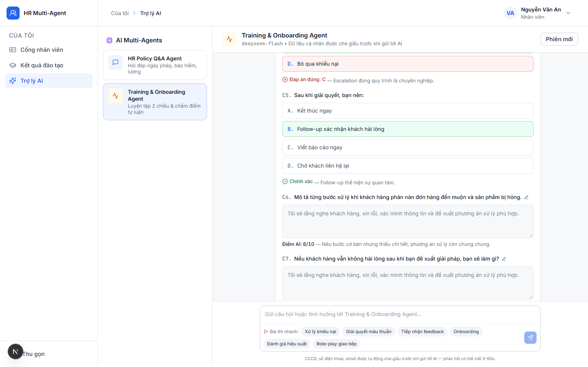

# 🇻🇳 Sửa Quiz Đào Tạo Tiếng Việt & Chấm Tự Luận (05-11-2026)

> [!IMPORTANT]
> Sửa 3 lỗi liên tiếp trong WF03: câu hỏi bị sinh không dấu, đáp án đúng không hiển thị, và nhận xét tự luận trống. Không đổi nghiệp vụ chấm điểm; chỉ sửa prompt/fallback, cách backend truyền đáp án và cách UI đọc kết quả.

## 1. Hiện tượng

- Câu hỏi và phương án hiện kiểu `Khi khach hang phan nan...`, `Bien ho cho cong ty...`.
- Sau khi nộp: `Đáp án đúng: —`, `Điểm AI: --/10`.
- Kết quả tổng chỉ còn `He thong cham diem tu dong.`

## 2. Nguyên nhân

### 2.1. Quiz không dấu

- Fallback trong node `Format Quiz Output` của WF03 viết ASCII.
- Prompt và system message cũng không yêu cầu “tiếng Việt có dấu”.

### 2.2. Mất đáp án đúng

- `agents.service` strip `correct` khỏi quiz public để chống tự chấm.
- UI `QuizCard` lại đọc `q.correct` → luôn `undefined` → hiện `—`.
- Ngoài ra `loadServerQuizAnswers` lấy **message assistant mới nhất**, mà message mới nhất sau khi nộp là tin “đã chấm xong” (`metadata.grade`), không chứa `metadata.quiz` → server không tìm thấy đáp án.

### 2.3. Nhận xét tự luận trống

- Grader bị yêu cầu trả 7 kết quả + 4 tiêu chí.
- Vượt `maxTokens: 1024` → output rỗng → rơi vào fallback `results: []`, `essay_avg: 0`.

## 3. Cách sửa

### 3.1. WF03 (`n8n-workflows/03-training-agent.json`)

- `Load Scenario`: chính sách + mô tả kịch bản tiếng Việt có dấu.
- `Build Quiz Gen Prompt`: yêu cầu rõ **“tiếng Việt CÓ DẤU đầy đủ, không viết không dấu”**.
- `Format Quiz Output`:
  - Fallback 7 câu chuẩn tiếng Việt.
  - Nếu model trả quiz không dấu → dùng fallback có dấu.
- `Quiz Generator Agent`: system message yêu cầu dấu.
- **Grader chỉ chấm 2 câu tự luận**; MCQ do NestJS chấm deterministic.
- `Format Grade Output`: merge MCQ + essay, tính `score_percent`, `correct_count`, `essay_avg`, luôn có `feedback`.
- `Quiz Grader Agent`: system message “chỉ chấm tự luận, nhận xét tiếng Việt có dấu”.

### 3.2. Backend (`training.service.ts`)

- Load `correctById` **trước** khi gọi WF03.
- Gửi `answersForGrade` có `correctAnswer` server-side; không tin `correctAnswer` từ client.
- `loadServerQuizAnswers`:
  - Chấp nhận `scenarioType` lowercase lẫn uppercase.
  - Tìm trong 20 message gần nhất message nào có `metadata.quiz`, bỏ qua message `metadata.grade`.
- Trả `results` chuẩn hoá:
  - `correct_answer` cho MCQ.
  - `feedback` cho mọi câu.
  - Essay có `score`, `max_score`, `criteria`.

### 3.3. UI (`ai-agents-view.tsx`)

- `correctLetter = r.correct_answer ?? q.correct`.
- Câu sai hiện `Đáp án đúng: B/C`; câu đúng hiện `Chính xác`.
- Essay hiện điểm + nhận xét; điểm dùng dấu phẩy (`6,5/10`).
- `agents.api.ts` bổ sung type `correct_answer`.

### 3.4. Dữ liệu cũ

- Chuẩn hoá **39 tin nhắn text** và **4 quiz metadata** cũ trong `ai_chat_messages`.
- Script: `packages/database/scripts/fix-training-history-vi.cjs` (dry-run/apply).
- Sau khi sửa: lịch sử đào tạo còn **0** câu hỏi/nội dung ASCII.

## 4. Kiểm chứng

### API E2E

| Hạng mục | Kết quả |
|---|---|
| Số câu | 7 (5 MCQ + 2 tự luận) |
| Nội dung | Tiếng Việt có dấu |
| MCQ đúng | 3/5 |
| Tự luận | 7/10 và 4.5/10, có nhận xét |
| Tổng | 59% |
| `correct_answer` | Có cho từng MCQ |

### UI E2E

- Chọn A, B, C, D, B → 2/5 MCQ đúng.
- Câu sai hiện `Đáp án đúng: B/C`.
- Câu đúng hiện `Chính xác`.
- Tự luận hiện `Điểm AI: 6/10 — ...` và `4/10 — ...`.
- Tổng 45%, có `overall_feedback`.

## 5. File thay đổi

| File | Nội dung |
|---|---|
| `n8n-workflows/03-training-agent.json` | Prompt/fallback/grader tiếng Việt; chấm essay-only |
| `scripts/fix-training-quiz-vi.mjs` | Patch quiz prompt + fallback |
| `scripts/fix-training-quiz-grade-essays.mjs` | Patch grader essay-only |
| `packages/database/scripts/fix-training-history-vi.cjs` | Chuẩn hoá lịch sử chat cũ |
| `apps/api/src/training/training.service.ts` | Gửi correctAnswer, trả correct_answer/feedback |
| `apps/web/components/views/ai-agents-view.tsx` | Hiển thị đáp án + nhận xét |
| `apps/web/lib/api/agents.api.ts` | Type `correct_answer` |

## 6. Kiểm tra kỹ thuật

- `pnpm --filter web check-types` — pass.
- `pnpm --filter web lint` — pass (`--max-warnings 0`).
- `pnpm --filter api build` — pass.
- Import + publish WF03 vào n8n — thành công.
- Web `3000`, API `3001` — 200.

## 7. Còn lại

- [ ] Commit các thay đổi WF03 + API + UI + script.
- [ ] Nếu muốn giữ quiz card sau khi refresh: hydrate `metadata.quiz`/`metadata.grade` vào `ChatMessage` (hiện chỉ giữ tin nhắn text).
- [ ] Các quiz AI-generated cũ đã được thay bằng bộ chuẩn; nếu cần giữ nội dung gốc thì phục hồi từ backup DB.

---

*Liên kết:* [[35 - Audit Số Liệu, Sửa Encoding & Tinh Chỉnh Density (05-11-2026)]] | [[34 - Redesign Giao Diện Light Theme & Rà Soát UX Nhân Viên (04-11-2026)]] | [[03 - Web Portal (Next.js)]] | [[06 - n8n Workflows & AI Agents]]
